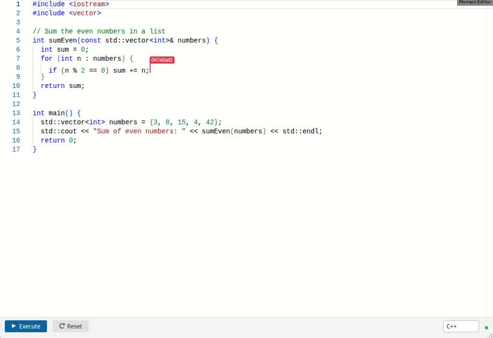

# Module Monaco Editor

A collaborative code editor module for [Edrys-Lite](https://github.com/edrys-labs/edrys-Lite) classrooms, built on [Monaco Editor](https://microsoft.github.io/monaco-editor/) with real-time CRDT sync.



## Usage

Add this URL to your Edrys-Lite classroom:

```
https://edrys-labs.github.io/module-monaco-editor/
```

The module is shown in every room (`show-in: *`).

## Configuration

All fields are optional; empty ones fall back to their defaults.

```json
{
  "value": "// initial code shown in the editor",
  "runCommand": "execute",
  "language": "cpp",
  "theme": "auto",
  "synchronize": true,
  "readOnly": false,
  "showLanguageSelector": true,
  "editorId": "editor1"
}
```

| Field | Type | Default | Description |
|---|---|---|---|
| `value` | string | `""` | Initial code pre-loaded into the editor. Also used as the reset target. With `synchronize`, it only seeds the room's shared code once: changing it later does not replace code already in the room. Press Reset, or use a new `editorId`. |
| `runCommand` | string | `"execute"` | Message subject sent to other modules when Execute is clicked. |
| `language` | string | `"cpp"` | Editor language. Any Monaco-supported language is valid (e.g. `python`, `javascript`, `rust`). |
| `theme` | string | `"auto"` | Editor color theme: `auto` (follows each device's dark/light preference), `vs-dark` or `vs-light`. |
| `synchronize` | boolean | `false` | Share one document across all peers in the room, edited in real time (CRDT). Without it, each peer edits its own copy. |
| `readOnly` | boolean | `false` | Make the editor read-only for all roles. |
| `showLanguageSelector` | boolean | `false` | Show a language dropdown to teachers and stations. With `synchronize`, a change applies to everyone. |
| `editorId` | string | `"default"` | Unique namespace for shared state. **Required when using multiple editors in the same room** — set a different value on each instance (e.g. `"editor1"`, `"editor2"`). |

Every boolean is off by default, as in the other Edrys modules, because the Edrys settings form saves `false`
for each checkbox you leave unticked. **Collaborative editing needs `synchronize: true`**.

The same fields can be set per role in `studentConfig`, `teacherConfig` or `stationConfig`, which override
`config` for that role. For example, `{ "readOnly": true }` as `studentConfig` lets only teachers and stations
edit.

## Role behavior

| Feature | Student | Teacher | Station |
|---|---|---|---|
| Edit code | yes | yes | yes |
| Execute button | yes | yes | yes |
| Reset button | no | yes (requires `value`) | yes (requires `value`) |
| Language selector | no | with `showLanguageSelector` | with `showLanguageSelector` |

Setting `readOnly: true` hides Execute and disables editing for all roles.

## Connecting to other modules

`runCommand` defines the message subject published when Execute is clicked. The message body is the current editor content (or the selected text if a selection exists).

Modules like [pyxtermjs](https://github.com/Cross-Lab-Project/edrys_module-pyxtermjs) can be configured to listen on this subject and execute the received code.

## Shared state

With `synchronize`, the editor keeps its state in the room, under keys named after `editorId`:

| Key | Type | Content |
|---|---|---|
| `monaco-<editorId>-code` | `Y.Text` | the code |
| `monaco-<editorId>-initialized` | value | `true` once `value` has been inserted |
| `monaco-<editorId>-language` | value | the language picked with the selector |

Remote cursors use the awareness channel `monaco-<editorId>-cursors`.

## Multiple editors in the same room

When placing more than one Monaco Editor module in the same room, set a unique `editorId` on each instance. Without it, all instances share the same CRDT state and will mirror each other.

```json
{ "editorId": "editor1", "language": "cpp", "synchronize": true }
{ "editorId": "editor2", "language": "python", "synchronize": true }
```

## Development

```bash
nvm use 24
npm install
npm run watch   # dev server on port 3001
npm run build   # production build → docs/
```

## License

[MIT](LICENSE) © edrys-labs
